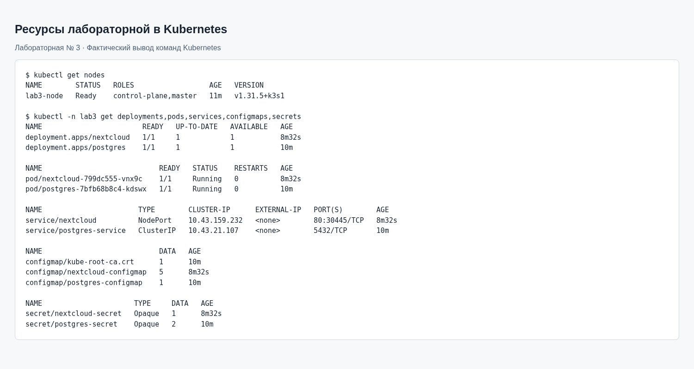
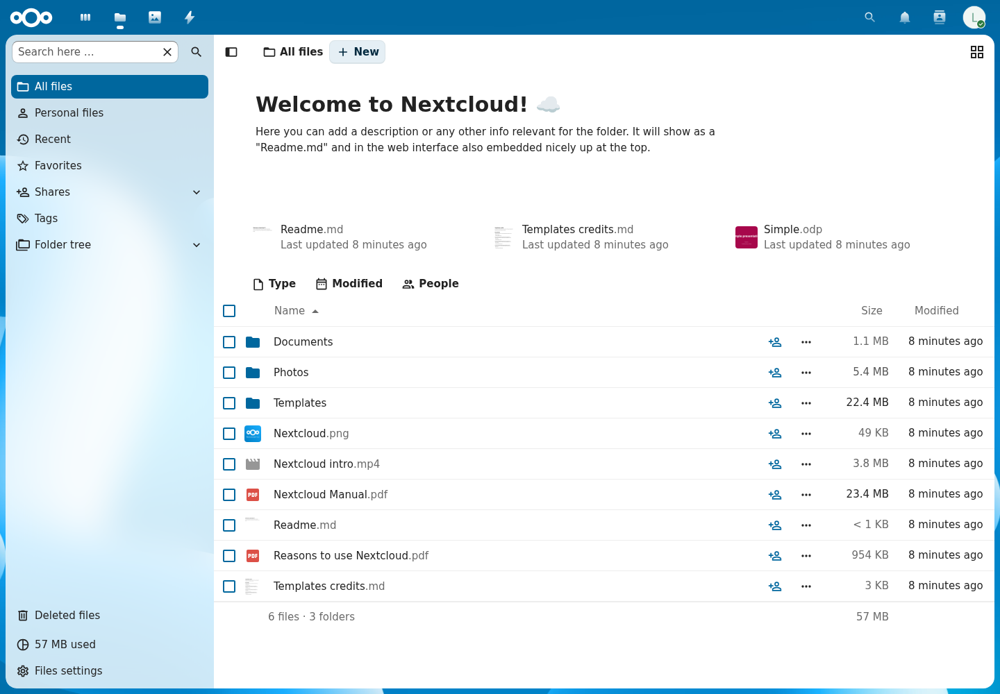
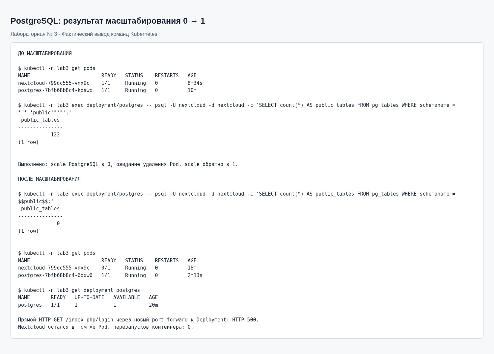

# Лабораторная работа № 3. Kubernetes

[Условие](lab3.pdf) · [Команды запуска](RUN.md)

## Ход работы

В локальном кластере k3s развернуты PostgreSQL 14 и Nextcloud 32.0.15. Все ресурсы находятся в namespace `lab3`, у каждого приложения одна реплика.

В манифесты из примера внесены следующие изменения:

- `POSTGRES_USER` и `POSTGRES_PASSWORD` перенесены в `pg_secret.yml`. Имя базы осталось в `pg_configmap.yml`.
- Обычные переменные Nextcloud вынесены в `nextcloud_configmap.yml`, пароль администратора оставлен в Secret. Настройки подключаются к контейнерам через `envFrom`.
- В `nextcloud.yml` добавлены Liveness и Readiness. Liveness проверяет TCP-порт 80, Readiness запрашивает `/index.php/login`. Startup-проба даёт приложению время на первую установку.

Сначала запущен PostgreSQL, затем, после готовности базы, Nextcloud. Оба Pod перешли в состояние `1/1 Running` без перезапусков.

Настройки проб и состояние `Ready=True` видны на [снимке describe pod](screenshots/02-probes.png).

Для доступа к интерфейсу использован `kubectl port-forward`. Вход под `lab3admin` прошёл успешно, в разделе Files отображается список файлов.

## Ответы на вопросы

### Важен ли порядок выполнения манифестов?

Да, для запуска контейнеров зависимости должны быть готовы. Namespace создаётся первым. Deployment можно создать раньше ConfigMap и Secret, но контейнер не запустится, пока они не появятся. Service можно создать до или после Pod: он выбирает их по меткам.

В этой работе сначала созданы настройки и PostgreSQL, затем выполнено ожидание готовности базы. После этого запущен Nextcloud, которому база нужна для первоначальной установки.

### Что произойдёт, если уменьшить число реплик PostgreSQL до 0, а затем вернуть 1?

В манифесте PostgreSQL используется `emptyDir`. При уменьшении числа реплик до 0 Pod удаляется вместе с данными. При возврате к одной реплике PostgreSQL создаёт пустую базу. Nextcloud остаётся в прежнем Pod с сохранённой конфигурацией, но его таблиц в базе уже нет.

Это проверено на стенде: до опыта было 122 таблицы, после пересоздания базы стало 0. PostgreSQL снова готов, а у Nextcloud состояние `0/1 Running`. Страница входа возвращает HTTP 500. Контейнер Nextcloud не перезапустился: веб-сервер продолжает слушать порт, поэтому Liveness проходит, а Readiness завершается ошибкой.

Для сохранения базы при удалении Pod нужен постоянный том, например PVC. Простое увеличение числа реплик потерянные данные не возвращает.

Изображения с командами оформлены из сохранённого вывода. Исходные тексты: [ресурсы](screenshots/01-resources.txt), [пробы](screenshots/02-probes.txt), [опыт с базой](screenshots/04-database-reset.txt). Снимок интерфейса сделан в браузере.
